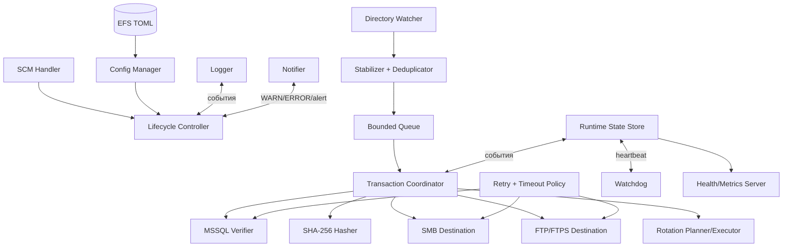
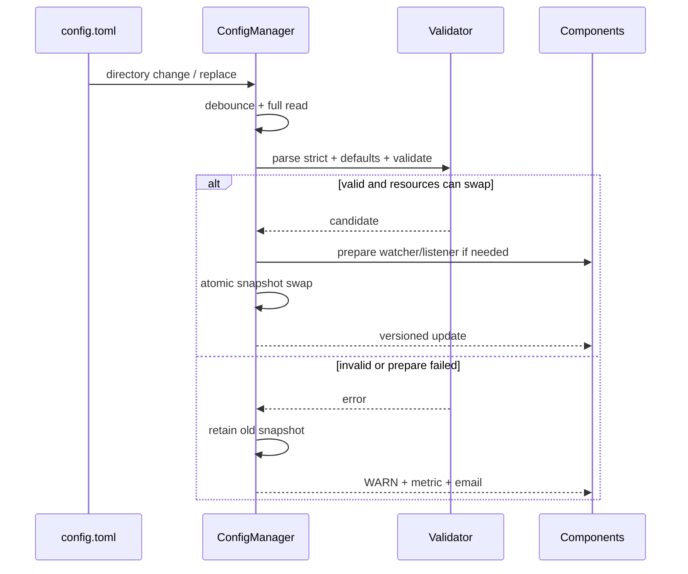

# Дизайн Midarda-Backup

## Overview

Midarda-Backup — Windows-only система на Go для обнаружения локальных файлов резервных копий MSSQL, их блокирующей проверки через MSSQL, доставки на независимые SMB и FTP/FTPS назначения, создания SHA-256 sidecar-файлов, ротации, мониторинга и уведомлений. Поставка содержит ровно два исполняемых файла для `windows/amd64`: консольный `installer.exe` и Windows-службу `midarda-backup.exe`.

Дизайн сохраняет принятые решения: TOML через `BurntSushi/toml`, EFS для всего файла конфигурации, событийный watcher на `ReadDirectoryChangesW`, `RESTORE VERIFYONLY`, UNC-доступ к SMB без диска, FTP/FTPS, текстовые русскоязычные логи с ротацией 5 МБ × 5, Health/Metrics на порту 91873 и SMTP. Детали ниже делают эти решения однозначными для реализации.

### Цели и границы

- Один локальный источник; ноль или один SMB и ноль или один FTP/FTPS destination, причём хотя бы один destination обязан быть включён.
- Один процесс службы, внутри которого компоненты связаны интерфейсами и `context.Context`; I/O-зависимости заменяемы тестовыми реализациями.
- MSSQL находится на том же сервере. Проверка MSSQL предшествует любому удалённому копированию и блокирует транзакцию при ошибке целостности.
- SMB и FTP — независимые ветви: сбой одной не отменяет попытку другой.
- В scope не входят GUI, плановые backup jobs MSSQL, восстановление БД, облачные хранилища, дедупликация содержимого и распределённая координация.

### Консервативные уточнения неоднозначностей

1. `ReadDirectoryChangesW` не выдаёт отдельного события «дескриптор закрыт». Событие создания/изменения только ставит путь в очередь стабилизации; готовность означает, что файл существует, его удаётся открыть без совместного доступа на запись/удаление и пара `(size, mtime)` не меняется весь `stabilization_delay`.
2. «Три уровня» означает файлы в корне (`depth=0`) и в каталогах глубины 1–2. Более глубокие пути игнорируются.
3. `max_attempts` — общее число попыток, включая первую; значение по умолчанию `1` означает отсутствие повтора.
4. Таймаут операции ограничивает полную попытку, а progress timeout срабатывает раньше, если в течение заданного интервала не увеличился счётчик обработанных байтов/не завершился MSSQL-запрос.
5. Ротация выполняется отдельно в каждой затронутой подпапке. Каждый обычный backup-файл и каждый `.sha256` является отдельной учитываемой записью, как прямо требует С-11; после сортировки по `(mtime DESC, path ASC)` сохраняются первые `keep`, остальные удаляются.
6. Локальная ротация относится к исходной подпапке под `watch_path`; удалённая — к соответствующей подпапке каждого успешно доступного назначения.
7. Успешная транзакция означает: MSSQL-проверка пройдена или выключена, и все включённые назначения успешно обработаны. Частичный успех отражается в health/metrics, но не обновляет `last_successful_transaction`.
8. При Pause новые транзакции не запускаются, текущая завершается; при Resume приём возобновляется. При Stop контексты отменяются, выполняется ограниченное ожидание завершения и служба сообщает SCM состояние `Stopped`.

### Результаты технического исследования

- [`ReadDirectoryChangesW`](https://learn.microsoft.com/en-us/windows/win32/api/winbase/nf-winbase-readdirectorychangesw) асинхронно сообщает изменения каталога, но не гарантирует отдельное событие закрытия файла; поэтому требуется описанная выше стабилизация и повторное сканирование после переполнения буфера.
- [EFS](https://learn.microsoft.com/en-us/windows/win32/fileio/file-encryption) работает на томах, объявляющих `FS_FILE_ENCRYPTION`, и прозрачно расшифровывает данные в контексте владельца ключа. Установщик обязан проверить файловую систему и фактический encrypt/decrypt round trip.
- [`RESTORE VERIFYONLY`](https://learn.microsoft.com/en-us/sql/t-sql/statements/restore-statements-verifyonly-transact-sql) проверяет комплектность и читаемость backup set, но не структуру данных как полноценное восстановление; это ограничение фиксируется в документации администратора.
- Windows-служба реализуется через [`golang.org/x/sys/windows/svc`](https://pkg.go.dev/golang.org/x/sys/windows/svc), а установщик управляет SCM через `mgr`; delayed auto-start и recovery actions настраиваются Win32/SCM API.

Материал по внешним источникам перефразирован с соблюдением лицензионных ограничений.

### Трассируемость верхнего уровня

| Область дизайна | Требования |
|---|---|
| Два бинарника, платформа, локализация | У-01–У-03, Н-01, Н-02, Н-05 |
| Установка/обновление/удаление, учётная запись, SCM | У-04–У-07, У-10, У-20–У-27, С-01, С-17 |
| Мастер и конфигурация | У-11–У-19, С-02, С-19, Н-06 |
| Наблюдение и стабилизация | С-03–С-05, С-36 |
| MSSQL | С-20–С-24, С-37 |
| SMB/FTP/SHA-256 | С-06–С-10, С-38 |
| Ротация | С-11–С-13 |
| Timeout/retry/watchdog | С-29–С-35 |
| Логи/health/metrics/email | С-14–С-16, С-25–С-28, С-39–С-43 |
| Документация и тесты | Н-03, Н-04, Н-07 |

## Architecture

### Контекст и границы процессов

```mermaid
flowchart LR
    Admin[Администратор] --> Installer[installer.exe]
    Installer --> WinUser[Локальная учётная запись]
    Installer --> EFS[(config.toml / EFS)]
    Installer --> SCM[Windows SCM]
    SCM --> Service[midarda-backup.exe]
    Service --> Source[(Локальная папка)]
    Service --> SQL[(Локальный MSSQL)]
    Service --> SMB[(SMB UNC)]
    Service --> FTP[(FTP/FTPS)]
    Service --> SMTP[SMTP]
    Monitor[Prometheus / Zabbix / оператор] --> API[/health и /metrics]
    API --> Service
```

Установщик — синхронный orchestration process с консольным журналом. Служба — долгоживущий процесс под `midarda-backup`, принимающий команды SCM и владеющий watcher, worker, watchdog, HTTP и SMTP-компонентами. Секреты не передаются через аргументы командной строки.

### Внутренняя архитектура службы



`Transaction Coordinator` обрабатывает очередь одним worker по умолчанию. Это исключает гонки ротации и повторную запись одного назначения без расширения scope. Очередь ограничена; повторные события одного нормализованного пути объединяются. Переполнение не теряет данные: watcher ставит флаг rescan и после освобождения очереди выполняет рекурсивный scan допустимой глубины.

### Структура Go-модуля

```text
midarda-backup/
├── go.mod
├── cmd/
│   ├── installer/main.go
│   └── service/main.go
├── internal/
│   ├── app/                 # сборка dependency graph, lifecycle
│   ├── config/              # TOML model, defaults, validation, snapshots
│   ├── installer/           # install/upgrade/uninstall orchestration
│   ├── winaccount/          # local user, token, SeServiceLogonRight
│   ├── winefs/              # volume check, EFS encrypt/status
│   ├── winacl/              # owner/DACL construction and verification
│   ├── winscm/              # service registration, delayed start, recovery
│   ├── winservice/          # svc.Handler, Pause/Resume/Stop
│   ├── watcher/             # ReadDirectoryChangesW, depth/filter/rescan
│   ├── stabilize/           # exclusive-open and unchanged-window logic
│   ├── transaction/         # state machine and destination isolation
│   ├── integrity/           # MSSQL RESTORE VERIFYONLY
│   ├── checksum/            # SHA-256 and sidecar codec
│   ├── destination/
│   │   ├── smb/             # UNC copy, atomic publish, verify
│   │   └── ftp/             # FTP, explicit FTPS, transfer/publish
│   ├── rotation/            # deterministic plan and deletion
│   ├── resilience/          # timeout, progress timeout, backoff
│   ├── watchdog/            # core heartbeat and restart request
│   ├── notify/              # SMTP and alert fan-out
│   ├── observability/       # text logger, runtime state, metrics
│   └── health/              # subnet middleware, /health, /metrics
├── test/
│   ├── integration/
│   └── e2e/
└── docs/
    ├── README.md
    ├── admin-guide.md
    └── deployment.md
```

Пакеты под `internal` не импортируют `cmd`. Направление зависимостей: adapters (`watcher`, `integrity`, `destination`, Win32) реализуют интерфейсы orchestration-пакетов (`installer`, `transaction`, `app`); `config` и чистые модели не зависят от I/O.

### Развёртывание

```text
%ProgramData%\Midarda-Backup\
├── midarda-backup.exe
├── config.toml                 # EFS, владелец midarda-backup
├── logs\
│   ├── midarda-backup.log
│   └── midarda-backup.log.1..5
└── docs\
    ├── README.md
    ├── admin-guide.md
    └── deployment.md
```

`installer.exe` запускается из произвольного места и может опционально быть скопирован в каталог приложения, но контракт поставки остаётся двумя EXE. Рабочий каталог службы не используется для разрешения путей; все пути абсолютные.

## Components and Interfaces

### Установщик и Windows lifecycle

```go
type InstallMode string
const (
    ModeInstall   InstallMode = "install"
    ModeUpgrade   InstallMode = "upgrade"
    ModeUninstall InstallMode = "uninstall"
)

type AccountManager interface {
    EnsureLocalUser(ctx context.Context, name string, password Secret) (created bool, err error)
    GrantServiceLogon(ctx context.Context, name string) error
    Logon(ctx context.Context, name string, password Secret) (windows.Token, error)
    DeleteLocalUser(ctx context.Context, name string) error
}

type ServiceManager interface {
    Install(ctx context.Context, spec ServiceSpec, password Secret) error
    ConfigureDelayedAutoStart(ctx context.Context, name string) error
    ConfigureRecovery(ctx context.Context, name string, policy RecoveryPolicy) error
    StartAndWait(ctx context.Context, name string, timeout time.Duration) error
    StopAndDelete(ctx context.Context, name string, timeout time.Duration) error
}

type SecurityManager interface {
    ApplyOwnerAndACL(path string, ownerSID windows.SID) error
    EncryptForToken(path string, token windows.Token) error
    VerifyEncryptedAndReadable(path string, token windows.Token) error
}
```

Порядок `install`:

1. Проверить `windows/amd64`, поддерживаемую версию Windows Server и elevated token. Если процесс не elevated — один раз запросить `runas`; отказ UAC завершает установку до мутаций.
2. Собрать пароль без echo, создать/обновить `midarda-backup`, назначить `SeServiceLogonRight`, создать/загрузить профиль и получить token пользователя.
3. Создать `%ProgramData%\Midarda-Backup`, скопировать бинарник/документацию с заменой через временный файл и rename.
4. Запустить отдельный шаг мастера: получить source, destinations, retention, MSSQL, health subnet, SMTP; пустой destination выключает его; при отсутствии обоих повторить ввод.
5. Проверить source и destinations под impersonation token `midarda-backup`: создать криптографически случайный тестовый файл, прочитать и удалить его. Для FTP применяется настроенная FTP-учётная запись, но сам мастер и локальные/SMB операции идут под service token.
6. Сериализовать валидный TOML во временный файл, включая требуемый У-09 пароль service account, атомарно заменить `config.toml`, затем зашифровать EFS именно под profile/token `midarda-backup`; проверить encrypted attribute и чтение тем же token. При отсутствии EFS удалить незашифрованный временный файл и прервать установку.
7. Назначить владельца каталога `midarda-backup`; отключить наследование DACL; выдать Full Control только SID `midarda-backup` и `SYSTEM`. Явные deny ACE не добавлять: они способны перекрыть разрешения; отсутствие ACE для остальных реализует требуемый запрет.
8. Зарегистрировать `Midarda-Backup` под `.\midarda-backup`, Automatic (Delayed Start), передать пароль SCM, настроить restart recovery actions, запустить и дождаться SCM Running, затем вызвать `/health` с локального разрешённого адреса.
9. На каждом шаге печатать русское цветное INFO/WARN/ERROR. Файлового лога установщика нет. Секреты маскируются.

Ошибка мастера не вызывает rollback уже созданных пользователя, каталога и файлов (У-21). До мастера ошибки прекращают дальнейшие действия; идемпотентные шаги позволяют повторный запуск.

`upgrade` останавливает службу, спрашивает о сохранении конфига, заменяет бинарники. При сохранении — проверяет чтение/валидацию существующего EFS-конфига и не переписывает его; иначе запускает мастер и EFS lifecycle заново. Затем повторно применяет ACL/SCM policy и запускает health-check.

`uninstall` сначала останавливает и удаляет службу. Отдельные подтверждения управляют удалением конфигурации/файлов и локального пользователя. Пользователь удаляется последним, чтобы не потерять EFS-ключ до решения о конфиге. Отказ от удаления пользователя или файлов не считается ошибкой.

### Управление службой

`svc.Handler.Execute` принимает `Stop`, `Shutdown`, `Pause`, `Continue` и регулярно сообщает SCM актуальное состояние. `Pause` закрывает gate запуска транзакций, не останавливая HTTP/watchdog; `Continue` открывает gate. `Stop/Shutdown` отменяет root context, закрывает watcher/listener, прекращает новые retry, ждёт текущую операцию не дольше `shutdown_timeout`, flush-ит лог и возвращается.

SCM recovery policy: restart service после non-zero process exit, включая exit watchdog. Сам процесс не вызывает `sc.exe` и не требует административных прав. Watchdog сначала делает best-effort лог/email, затем завершает процесс специальным exit code; уведомление о перезапуске отправляется также при следующем старте, если marker-файл содержит причину watchdog.

### Конфигурация, валидация и hot reload

```go
type ConfigLoader interface {
    Load(path string) (Config, error)
}

type ConfigManager interface {
    Current() ConfigSnapshot
    Reload(ctx context.Context) error
    Subscribe() <-chan ConfigSnapshot
}

type ConfigSnapshot struct {
    Version uint64
    LoadedAt time.Time
    Value Config
}
```

Парсинг выполняется `BurntSushi/toml` в strict mode: ошибки синтаксиса, неизвестные ключи (`MetaData.Undecoded`) и нарушение cross-field invariants отклоняют snapshot. Defaults применяются до validation, но только к отсутствующим полям. Секреты исключены из `%v`/JSON/логов.

Hot reload использует уведомление каталога о замене `config.toml` плюс debounce. Новый файл полностью читается под service account, декодируется и валидируется во временный immutable snapshot. Только после успеха `atomic.Pointer` заменяет текущий snapshot, и подписчики применяют динамические поля. Текущая транзакция продолжает со snapshot, захваченным при старте; новые получают новую версию. При ошибке остаётся предыдущая версия, увеличивается метрика reload errors, пишется WARN и отправляется email при включённых уведомлениях.

Динамически применяются маски, delay, destinations, limits, timeout/retry, MSSQL, SMTP, allowed subnet и log level. Изменение `watch_path`, `watch_depth` или health port приводит к controlled swap: новый watcher/listener должен успешно запуститься до остановки старого; иначе весь snapshot отклоняется. `service_account.username` неизменяем; его изменение требует переустановки.

Основные invariants validation:

- `watch_path` — абсолютный существующий локальный каталог; `watch_depth == 3` в пользовательском смысле «корень + 2 вложенных»;
- непустые валидные masks; хотя бы один из `smb.enabled`/`ftp.enabled`;
- SMB path при включении — абсолютный UNC, не drive letter; FTP URL — `ftp://` для plain/explicit TLS, host/port заданы;
- retention `local_keep >= 0`, `remote_keep >= 0`; ноль означает удалить все учитываемые записи после успешной обработки;
- `max_attempts >= 1`, `initial_backoff > 0`, `multiplier >= 1`, `max_backoff >= initial_backoff`;
- operation/progress timeout положительны, progress timeout не больше operation timeout;
- health port `1..65535`, subnet — один CIDR;
- при MSSQL SQL-auth обязательны username/password, при Windows-auth они пусты;
- при email enabled обязательны host, port, from и хотя бы один recipient.

### Наблюдение, стабилизация и очередь

```go
type FileWatcher interface {
    Events() <-chan FileEvent
    Errors() <-chan error
    Rescan(ctx context.Context) error
    Close() error
}

type Stabilizer interface {
    WaitReady(ctx context.Context, path string, delay time.Duration) (FileIdentity, error)
}

type FileIdentity struct {
    CanonicalPath string
    Size int64
    ModTime time.Time
    FileID uint64
}
```

Watcher открывает root directory с overlapped I/O и `bWatchSubtree=TRUE`, фильтрует события создания, rename-to и size/last-write. После canonicalization он отвергает пути вне root, каталоги, глубину >2 и несовпадающие masks. Сравнение масок case-insensitive по Windows semantics. `.sha256` не является входным backup-файлом.

Deduplicator хранит состояния `pending/running/processed(identity)`. Новое событие pending-path сбрасывает stabilization timer; событие для running-path ставит `dirty`, вызывая повторную стабилизацию после текущей транзакции. `FileID + size + mtime` не допускают подавления нового файла, переименованного в прежнее имя.

### Транзакция обработки

```go
type IntegrityVerifier interface {
    Verify(ctx context.Context, path string, cfg MSSQLConfig, progress Progress) error
}

type Destination interface {
    Name() string
    Put(ctx context.Context, object Object, progress Progress) (RemoteObject, error)
    Verify(ctx context.Context, object RemoteObject, expected SHA256) error
    List(ctx context.Context, dir string) ([]Entry, error)
    Delete(ctx context.Context, path string) error
}

type Coordinator interface {
    Process(ctx context.Context, file FileIdentity, cfg ConfigSnapshot) TransactionResult
}
```

```mermaid
sequenceDiagram
    participant W as Watcher
    participant S as Stabilizer
    participant T as Coordinator
    participant M as MSSQL
    participant D1 as SMB
    participant D2 as FTP/FTPS
    participant R as Rotator
    W->>S: path changed
    S->>S: exclusive open + unchanged window
    S->>T: stable FileIdentity + ConfigSnapshot
    opt MSSQL enabled
        T->>M: RESTORE VERIFYONLY
        alt verify failed
            M-->>T: integrity error
            T-->>T: ERROR + email; stop transaction
        end
    end
    T->>T: stream SHA-256; create local sidecar
    par independent destinations
        T->>D1: upload backup + sidecar
        opt SMB verify enabled
            D1->>D1: read-back SHA-256 and compare
        end
    and
        T->>D2: upload backup + sidecar
        D2-->>T: transfer success is sufficient
    end
    T->>R: rotate local and successful destinations
    T-->>T: update state/log/metrics
```

Порядок строгий: MSSQL → local checksum sidecar → для каждого destination backup → sidecar → optional SMB read-back → destination rotation → local rotation. MSSQL failure запрещает hash/copy/rotation. Ошибка одного destination записывается и не прерывает другой. Ротация destination запускается только после успешной публикации обоих объектов этого destination; локальная — после завершения обеих destination branches, даже если одна была недоступна.

### MSSQL `RESTORE VERIFYONLY`

Реализация использует `database/sql` и SQL Server driver. Windows-auth выполняется в контексте службы/учётной записи, под которой доступен SQL Server; SQL-auth использует секреты конфига. SQL выполняется на локальном instance:

```sql
RESTORE VERIFYONLY FROM DISK = N'<escaped-absolute-path>';
```

Идентификатор файла не параметризуется драйвером внутри `RESTORE`; поэтому путь обязан быть canonical absolute path внутри `watch_path`, NUL запрещён, одинарные кавычки удваиваются. Запрос исполняется с attempt context timeout. SQL Server service account должен иметь read access к source — это проверяет мастер. Любая SQL error/timeout трактуется как невозможность подтвердить целостность: копирование блокируется, ERROR и email обязательны. В health различаются `reachable`, `last_verify_ok` и текст безопасной категории ошибки. Документация подчёркивает, что VERIFYONLY не является тестовым восстановлением.

### SHA-256, SMB и FTP/FTPS

`checksum` потоково читает backup, выдаёт lowercase hex и атомарно создаёт `<name>.sha256` в формате:

```text
<64 lowercase hex><space><space><original-base-name>\n
```

SMB работает с UNC путями непосредственно через Windows file APIs под service account, не создаёт drive mapping. Относительная структура source сохраняется. Backup и sidecar сначала пишутся как уникальные `.partial-<transaction-id>` в целевой подпапке, flush-ятся и атомарно переименовываются. При `verify_after_copy.smb=true` опубликованный backup повторно читается, SHA-256 сравнивается с ожидаемым; mismatch удаляет/карантинирует повреждённую публикацию и является retryable error. Каждая retry attempt заново публикует backup и sidecar.

FTP adapter поддерживает:

- plain FTP при `tls=false`;
- explicit FTPS (`AUTH TLS`) при `tls=true`, с проверкой цепочки и hostname; отключение проверки сертификата не предусмотрено;
- passive mode, бинарный `TYPE I`, credentials из config;
- временное имя и `RNFR/RNTO`, если сервер поддерживает rename; иначе прямая `STOR` считается опубликованной только после успешного финального ответа;
- загрузку backup и `.sha256`; обратное checksum-считывание не выполняется — достаточен успешный протокольный ответ.

FTP/SMB adapter никогда не логирует пароль/URL userinfo. Все handles/connections закрываются при cancel/error.

### Retry, timeout, progress timeout и watchdog

```go
type RetryPolicy struct {
    MaxAttempts int
    Initial time.Duration
    Maximum time.Duration
    Multiplier float64
}

type Progress interface { Add(bytes int64); Beat() }

type Runner interface {
    Do(ctx context.Context, op OperationKind, fn func(context.Context, Progress) error) error
}
```

Для attempt `i` (первая имеет `i=1`) задержка перед следующей попыткой равна `min(maximum, initial * multiplier^(i-1))`; jitter не используется, чтобы поведение было воспроизводимо. Retry только для timeout, progress stall, временных сетевых/SQL ошибок и SMB checksum mismatch. Ошибки validation, auth, TLS certificate, path escape и MSSQL integrity result — permanent. Root cancellation прекращает ожидание немедленно.

У каждой попытки собственный operation deadline. Progress monitor отменяет attempt, если `now-lastProgress > progress_timeout`; для MSSQL `Beat` вызывается при старте, а отсутствие завершения контролируется progress timeout. Stall приводит к cancel, WARN/ERROR по итоговому исчерпанию и email. Освобождение goroutine/handle обязательно до следующей попытки.

Core heartbeat обновляет coordinator при dequeue, завершении этапа и в idle tick. Отдельный watchdog goroutine не участвует в обработке. Если возраст heartbeat строго больше `watchdog_timeout`, он атомарно фиксирует stall один раз, пишет marker, логирует, best-effort отправляет email с коротким deadline и завершает процесс non-zero. SCM recovery action запускает новый процесс; startup читает marker, отправляет уведомление о перезапуске и удаляет marker. `watchdog_timeout` обязан превышать idle heartbeat interval и не подменяет operation timeout.

### Ротация

```go
type Entry struct {
    Path string
    ModTime time.Time
    IsDir bool
}

type RotationPlan struct {
    Keep []Entry
    Delete []Entry
}

type Rotator interface {
    Plan(entries []Entry, keep int) RotationPlan
    Execute(ctx context.Context, dst Destination, plan RotationPlan) error
}
```

Планировщик берёт только обычные файлы непосредственной целевой подпапки, включая `.sha256` и незнакомые расширения, исключая каталоги и активные `.partial-*`. Сортировка стабильна: `ModTime` по убыванию, затем normalized path по возрастанию. `Delete = sorted[min(keep,len):]`, поэтому удаляются все излишки, а повторный запуск идемпотентен. Ошибка одного удаления не останавливает остальные; итог содержит все ошибки. Неуспешный list запрещает delete (fail-safe).

### Health, Metrics, логирование и email

HTTP server слушает configured port (по умолчанию 91873). Middleware извлекает IP из socket `RemoteAddr`; `X-Forwarded-For` игнорируется, потому что доверенный proxy не задан. IP должен принадлежать `allowed_subnet`, иначе `403`; malformed address даёт `400`. Разрешение применяется к обоим endpoints.

- `GET /health` — `200` для `healthy/degraded`, `503` для `unhealthy`; другие методы — `405`; JSON UTF-8, `Cache-Control: no-store`.
- `GET /metrics` — Prometheus text exposition. Совместимость с Zabbix означает возможность HTTP-agent читать те же числовые series; отдельный Zabbix-протокол не вводится.

Минимальные metrics: `midarda_transactions_total{result}`, `midarda_destination_operations_total{destination,result}`, `midarda_operation_duration_seconds{operation}`, `midarda_retries_total{operation}`, `midarda_copy_bytes_total{destination}`, `midarda_config_reload_total{result}`, `midarda_alerts_total{severity}`, `midarda_watchdog_heartbeat_age_seconds`, `midarda_copies{location,group}`. Labels не содержат полные пути, имена файлов или ошибки.

Текстовый logger выдаёт UTC timestamp, level, component, transaction ID и русское сообщение. Размер active file ≤5 MiB с ротацией до пяти архивов; installer пишет только console. Поля password/token/connection string/email auth всегда redact.

Notifier принимает typed event. Если email enabled, все WARN, ERROR и alerts ставятся в ограниченную асинхронную очередь; отправка SMTP имеет timeout и не блокирует основную транзакцию. Переполнение очереди логируется и измеряется. TLS — STARTTLS на configured SMTP port с проверкой сертификата; auth включается только при наличии credentials.

## Data Models

### Конфигурация

```go
type Config struct {
    General GeneralConfig `toml:"general"`
    ServiceAccount ServiceAccountConfig `toml:"service_account"`
    SMB SMBConfig `toml:"smb"`
    FTP FTPConfig `toml:"ftp"`
    MSSQL MSSQLConfig `toml:"mssql_integrity_check"`
    Rotation RotationConfig `toml:"rotation"`
    Retry RetryConfig `toml:"retry"`
    Timeouts TimeoutConfig `toml:"timeouts"`
    Watchdog WatchdogConfig `toml:"watchdog"`
    Health HealthConfig `toml:"health"`
    Email EmailConfig `toml:"email"`
}

type GeneralConfig struct {
    WatchPath string `toml:"watch_path"`
    WatchDepth int `toml:"watch_depth"`
    FileMasks []string `toml:"file_mask"`
    StabilizationDelay time.Duration `toml:"stabilization_delay"`
    LogLevel string `toml:"log_level"`
}

type ServiceAccountConfig struct {
    Username string `toml:"username"`
    Password Secret `toml:"password"`
}

type SMBConfig struct {
    Enabled bool `toml:"enabled"`
    Path string `toml:"path"`
    VerifyAfterCopy bool `toml:"verify_after_copy"`
}

type FTPConfig struct {
    Enabled bool `toml:"enabled"`
    URL string `toml:"url"`
    TLS bool `toml:"tls"`
    Username string `toml:"username"`
    Password Secret `toml:"password"`
}

type MSSQLConfig struct {
    Enabled bool `toml:"enabled"`
    Instance string `toml:"instance"`
    Auth string `toml:"auth"` // windows | sql
    Username string `toml:"username"`
    Password Secret `toml:"password"`
}
```

```toml
[general]
watch_path = "D:\\BackUp"
watch_depth = 3
file_mask = ["*.bak", "*.trn"]
stabilization_delay = "5s"
log_level = "INFO"

[service_account]
username = "midarda-backup"
password = "<секрет>"

[smb]
enabled = true
path = "\\\\FS-01\\BackUp"
verify_after_copy = true

[ftp]
enabled = false
url = "ftp://fs-01:21"
tls = true
username = ""
password = ""

[mssql_integrity_check]
enabled = true
instance = ".\\SQLEXPRESS"
auth = "windows"
username = ""
password = ""

[rotation]
local_keep = 3
remote_keep = 5

[retry]
max_attempts = 1
initial_interval = "5s"
max_interval = "300s"
multiplier = 2.0

[timeouts]
smb_operation = "300s"
ftp_operation = "300s"
mssql_operation = "300s"
progress = "60s"
shutdown = "30s"

[watchdog]
heartbeat_interval = "5s"
timeout = "120s"

[health]
port = 91873
allowed_subnet = "192.168.1.0/24"

[email]
enabled = true
smtp_host = "smtp.example.com"
smtp_port = 587
smtp_tls = true
smtp_username = ""
smtp_password = ""
from = "midarda-backup@example.com"
to = ["admin@example.com"]
```

### Runtime-модели

```go
type TransactionStatus string
const (
    TxRunning TransactionStatus = "running"
    TxSucceeded TransactionStatus = "succeeded"
    TxPartial TransactionStatus = "partial"
    TxFailed TransactionStatus = "failed"
)

type TransactionResult struct {
    ID string
    File FileIdentity
    ConfigVersion uint64
    StartedAt time.Time
    FinishedAt time.Time
    IntegrityChecked bool
    Destinations map[string]DestinationResult
    LocalRotation RotationResult
    Status TransactionStatus
    ErrorClass string // безопасная категория, не сырой секретный текст
}

type ResourceHealth struct {
    Enabled bool `json:"enabled"`
    Status string `json:"status"` // disabled|ok|degraded|error
    Reachable bool `json:"reachable"`
    Writable *bool `json:"writable,omitempty"`
    LastSuccess *time.Time `json:"last_success,omitempty"`
    LastErrorClass string `json:"last_error_class,omitempty"`
}

type HealthResponse struct {
    Status string `json:"status"`
    Timestamp time.Time `json:"timestamp"`
    ConfigVersion uint64 `json:"config_version"`
    LastSuccessfulTransaction *time.Time `json:"last_successful_transaction"`
    Resources map[string]ResourceHealth `json:"resources"`
    Copies map[string]map[string]int `json:"copies"`
    Watchdog struct {
        LastHeartbeat time.Time `json:"last_heartbeat"`
        AgeSeconds float64 `json:"age_seconds"`
    } `json:"watchdog"`
}
```

`RuntimeState` обновляется через один synchronized store и возвращает immutable snapshots HTTP handler. `Copies` группирует файлы по подпапке/логическому stem без high-cardinality metrics labels; фактический rotation count всегда основан на записях каталога, а не на кэше health.

## Correctness Properties

*Свойство — это характеристика или поведение, которое должно оставаться истинным при всех допустимых выполнениях системы, то есть формальное утверждение о том, что должна делать система. Свойства связывают человекочитаемую спецификацию с машинно проверяемыми гарантиями корректности.*

Метод property-based testing применим к чистым частям Midarda-Backup: нормализации и валидации конфигурации, path filtering, стабилизации как state machine, checksum codec, orchestration с fake adapters, rotation planner, retry policy, CIDR policy и сериализации health state. Он не применяется непосредственно к EFS, SCM, Win32 watcher, SMB/FTP/MSSQL/SMTP и визуальному консольному выводу; для них предусмотрены integration/smoke/example tests.

**Рефлексия и консолидация свойств**

- Условия отдельных config sections объединены в свойство единой строгой валидации: принятие неполной конфигурации не должно зависеть от порядка проверок.
- С-11, С-12 и С-13 объединены: полный rotation plan уже одновременно проверяет eligibility, порядок и cardinality; отдельные свойства были бы избыточны.
- С-20, С-23 и С-37 объединены в MSSQL gate: он одновременно задаёт условие вызова, порядок и блокирование downstream.
- С-29, С-33, С-34, С-35 и retry-часть С-38 объединены в bounded retry execution; отдельное свойство checksum mismatch остаётся частью сгенерированных outcomes.
- Свойства UI/инфраструктуры не искусственно формализуются: они остаются явно трассируемыми integration/smoke tests.

### Property 1: Строгий round trip и инварианты конфигурации

Для любой допустимой `Config` сериализация в TOML и строгий разбор должны давать эквивалентную нормализованную конфигурацию; для любой конфигурации с неизвестным ключом, неверным типом либо нарушением cross-field invariant разбор/валидация должны вернуть ошибку и не выдавать применимый snapshot. В частности, whitespace destination выключается, допустима ровно конфигурация хотя бы с одним destination, auth/email/timeout поля согласованы.

**Validates: Requirements 2.5**
Связанные идентификаторы: У-15, У-16, С-22, С-25, С-29, Н-06

### Property 2: Безопасная фильтрация входных путей

Для любого root, набора допустимых масок и любого canonical path watcher должен принять файл тогда и только тогда, когда он находится внутри root, имеет глубину каталога от 0 до 2 включительно, не является `.sha256` и его basename case-insensitive соответствует хотя бы одной маске.

**Validates: Requirements 3.2**
Связанные идентификаторы: С-05, С-36

### Property 3: Стабильность необходима и достаточна для готовности

Для любой конечной последовательности наблюдений `(exclusiveOpen, size, mtime, elapsed)` stabilizer не должен объявлять файл готовым до первого непрерывного интервала длительностью не меньше `stabilization_delay`, в котором exclusive open успешно и `(size, mtime)` неизменны; после такого интервала он должен вернуть последнюю identity.

**Validates: Requirements 3.2**
Связанные идентификаторы: С-04

### Property 4: SHA-256 sidecar соответствует содержимому

Для любого конечного массива байтов и любого допустимого basename созданный sidecar должен содержать lowercase SHA-256 этих байтов и исходный basename, а разбор sidecar должен восстановить тот же digest и basename.

**Validates: Requirements 3.4**
Связанные идентификаторы: С-06

### Property 5: SMB-проверка принимает только неизменённую копию

Для любого source payload и любого SMB read-back payload при включённом `verify_after_copy` операция успешна тогда и только тогда, когда SHA-256 обоих payload совпадает; при выключенной проверке read-back не вызывается. Любое несовпадение классифицируется как retryable checksum mismatch.

**Validates: Requirements 3.4**
Связанные идентификаторы: С-07, С-38

### Property 6: Независимость назначений

Для любых результатов enabled SMB и FTP adapters coordinator должен попытаться обработать каждое включённое назначение независимо: ошибка одного не уменьшает число logical calls другого, а итоговый статус точно отражает `succeeded`, `partial` или `failed` по совокупности результатов.

**Validates: Requirements 3.4**
Связанные идентификаторы: С-10

### Property 7: Полный детерминированный план ротации

Для любого списка directory entries и любого `keep >= 0` rotation planner должен включить все и только обычные не-partial файлы (включая `.sha256`), упорядочить их по `(mtime DESC, normalizedPath ASC)`, сохранить первые `min(keep,n)` и удалить ровно оставшиеся `max(0,n-keep)`; повторное планирование после удаления должно иметь пустой delete set.

**Validates: Requirements 3.5**
Связанные идентификаторы: С-11, С-12, С-13

### Property 8: Атомарность горячей конфигурации

Для любого текущего валидного snapshot и любого candidate reload валидный candidate должен целиком стать snapshot версии `old.version+1`, а невалидный candidate должен оставить старые value и version без частичного применения; транзакция, начатая до swap, всегда наблюдает только старый snapshot.

**Validates: Requirements 3.1**
Связанные идентификаторы: С-19

### Property 9: MSSQL является блокирующим gate

Для любого файла, config flag и результата verifier: verifier вызывается ровно тогда, когда проверка включена; ни один hash/destination/rotation step не начинается до его успешного завершения; любая ошибка проверки приводит к нулю downstream calls и ровно одному ERROR и alert event.

**Validates: Requirements 3.3**
Связанные идентификаторы: С-20, С-23, С-37

### Property 10: Retry ограничен попытками, timeout и exponential backoff

Для любой валидной retry policy, operation timeout и последовательности классифицированных outcomes runner должен выполнить не больше `max_attempts` попыток, прекратить выполнение при первом успехе/permanent error/root cancellation, дать каждой попытке отдельный deadline и использовать между retryable failures задержку `min(maximum, initial × multiplier^(i-1))`; все mismatch outcomes SMB следуют тем же правилам.

**Validates: Requirements 3.7**
Связанные идентификаторы: С-29, С-33, С-34, С-35, С-38

### Property 11: Детектор отсутствия прогресса имеет строгую границу

Для любого положительного progress timeout и любого времени последнего progress operation считается зависшей тогда и только тогда, когда возраст progress строго больше timeout; любой `Add` или `Beat` переносит границу относительно нового timestamp.

**Validates: Requirements 3.6**
Связанные идентификаторы: С-30

### Property 12: Полный fan-out уведомлений

Для любой последовательности typed events при включённом email каждый WARN, ERROR и alert должен быть поставлен в notifier queue ровно один раз, а DEBUG/INFO — ни разу; при выключенном email ни одно событие не ставится в SMTP queue.

**Validates: Requirements 3.10**
Связанные идентификаторы: С-26

### Property 13: CIDR — единственный источник решения о доступе

Для любого валидного CIDR, socket remote IP и произвольных HTTP headers запрос к `/health` или `/metrics` разрешается тогда и только тогда, когда remote IP принадлежит CIDR; изменение `X-Forwarded-For` не меняет решение.

**Validates: Requirements 3.9**
Связанные идентификаторы: С-40

### Property 14: Health JSON является полным безопасным представлением состояния

Для любого runtime snapshot сериализация и обратный JSON decode должны сохранить status, timestamp, config version, последнее успешное время, состояния SMB/FTP/MSSQL, copy counts и heartbeat; результат не должен содержать ни один secret из конфигурации или raw error.

**Validates: Requirements 3.9**
Связанные идентификаторы: С-41

## Error Handling

### Таксономия

```go
type ErrorClass string
const (
    ErrValidation ErrorClass = "validation"
    ErrPermission ErrorClass = "permission"
    ErrAuthentication ErrorClass = "authentication"
    ErrIntegrity ErrorClass = "integrity"
    ErrUnavailable ErrorClass = "unavailable"
    ErrTimeout ErrorClass = "timeout"
    ErrStalled ErrorClass = "stalled"
    ErrChecksumMismatch ErrorClass = "checksum_mismatch"
    ErrProtocol ErrorClass = "protocol"
    ErrCanceled ErrorClass = "canceled"
    ErrInternal ErrorClass = "internal"
)

type OpError struct {
    Class ErrorClass
    Operation string
    Resource string
    Retryable bool
    Cause error // только для внутреннего лога после redaction
}
```

Adapter обязан преобразовать platform/library errors в `OpError`; coordinator не определяет retryability по строке. В публичный health и metric label попадает только bounded `ErrorClass`.

| Ситуация | Поведение | Лог/Email | Health |
|---|---|---|---|
| Невалидный startup config/EFS unreadable | служба не входит в рабочий цикл, non-zero exit | ERROR, email невозможен до config | unhealthy после SCM failure; installer показывает ошибку |
| Невалидный hot reload | сохранить прежний snapshot | WARN + email | degraded только если повторяется; reload counter |
| Watcher buffer overflow | rescan root, не завершать процесс | WARN | degraded до успешного rescan |
| Файл исчез во время стабилизации | снять pending; новое событие начнёт заново | INFO/WARN | не влияет |
| MSSQL verify fail | блокировать весь файл | ERROR + email | MSSQL error, transaction failed |
| SMB или FTP unavailable | продолжить второе назначение | WARN/ERROR + email | destination error, transaction partial/failed |
| SMB checksum mismatch | удалить/quarantine partial, retry | WARN; ERROR+email после исчерпания | SMB error |
| Rotation list fail | не удалять ничего | ERROR + email | destination degraded |
| Отдельный delete fail | продолжить остальные delete, агрегировать | WARN/ERROR | degraded |
| Operation timeout/stall | cancel, закрыть ресурсы, retry если можно | WARN; ERROR+email в финале | resource degraded/error |
| SMTP fail/queue overflow | не менять transaction result | ERROR локально, metric | notifier degraded |
| Health request вне CIDR | отказ без раскрытия состояния | WARN rate-limited | HTTP 403 |
| Core heartbeat timeout | marker, best-effort email, non-zero exit | ERROR | SCM restart |

### Идемпотентность и частичные результаты

- Installer steps `Ensure*` допускают повтор после прерывания. Мастер не откатывает ранее созданные объекты.
- Destination publish использует уникальные temp names; остатки `.partial-*` старше configurable operation timeout удаляются при startup/retry housekeeping, но rotation их не считает.
- Повторная доставка того же identity заменяет одноимённые backup/sidecar атомарно. Coordinator не объявляет success до публикации обоих.
- Логи, metrics и notifier failures не скрывают исходную operation error и не образуют бесконечную рекурсию уведомлений.

## Наблюдаемость и эксплуатационные состояния

`healthy` означает: lifecycle running, config valid, heartbeat свежий, и все enabled resources имеют последний probe/operation success. `degraded` означает частичный destination/reload/rotation/notifier сбой при живом core. `unhealthy` означает stale heartbeat, startup failure или отсутствие возможности обрабатывать файлы. Disabled resource всегда `disabled`, а не `error`.

Каждая транзакция получает UUID и записывает этапы `detected`, `stable`, `verify_started/completed`, `copy_started/completed`, `rotation_started/completed`, `transaction_completed`. Полные source/destination пути допустимы только в защищённом файловом логе; metrics их не содержат. Health возвращает counts и error classes, но не credentials, SQL connection strings, SMTP recipients и сырые stack traces.

## Безопасность и жизненный цикл EFS/ACL

1. До записи секрета installer получает token и загружает профиль `midarda-backup`.
2. Plaintext TOML существует только во временном файле в каталоге с уже ограниченным DACL. После атомарной замены вызывается EFS encryption; installation success невозможен без encrypted attribute и read test под service token.
3. Каталог и дочерние объекты наследуют protected DACL с Full Control только для `SYSTEM` и `midarda-backup`; owner — service account. ACL повторно проверяется после upgrade.
4. Config открывает только служба под той же identity. API, log и errors не сериализуют secrets. Пароли не попадают в process arguments/environment.
5. TLS certificates FTP/SMTP проверяются стандартным trust store Windows и hostname. Plain FTP разрешён требованиями, но мастер выводит WARN.
6. Health bind допускает внешние интерфейсы, но CIDR middleware обязателен. Защита периметра firewall рекомендуется в admin guide как второй уровень.
7. Uninstall удаляет service до account; config/files — до account. Если config сохраняется, installer предупреждает, что удаление account сделает EFS data практически недоступными.
8. Admin guide обязан явно указать: обычная смена пароля при знании старого не ломает EFS; административный reset может лишить профиль доступа к EFS key; пароль logon в SCM нужно обновить отдельно; безопасный путь — штатная смена с прежним паролем либо переустановка.

**Примечание по У-09:** хранение пароля service account внутри EFS-конфига реализуется, поскольку это прямое требование, хотя runtime службе этот пароль для SCM не нужен. Поле используется только installer lifecycle и никогда не экспонируется.

## Сквозные сценарии

### Нормальная транзакция

1. Watcher получает изменение и нормализует путь.
2. Filter проверяет containment/depth/mask; deduplicator ставит pending.
3. Stabilizer ждёт exclusive-open и стабильное окно.
4. Coordinator фиксирует config snapshot и transaction ID.
5. При включённом MSSQL выполняет `RESTORE VERIFYONLY` с timeout.
6. Потоково вычисляет SHA-256 и атомарно создаёт local sidecar.
7. Независимо обрабатывает SMB и FTP: publish backup, publish sidecar, для SMB optional read-back verify.
8. Для успешно обработанного destination строит и исполняет remote rotation plan.
9. После destination branches выполняет local rotation.
10. Записывает result/state/metrics; только полный успех обновляет `last_successful_transaction`.

### Недоступен один destination

Coordinator сохраняет ошибку ветви, всё равно выполняет другую ветвь, ротирует только успешный remote destination и локальный source, создаёт `partial`, WARN/ERROR и email. После нового filesystem event файл может быть обработан снова; постоянная outbox/replay очередь требованиями не предусмотрена.

### Hot reload



## Testing Strategy

### Unit и property-based tests

Используется стандартный `testing` и библиотека [`pgregory.net/rapid`](https://pkg.go.dev/pgregory.net/rapid); собственный генератор PBT framework не реализуется. Каждое свойство реализуется **одним** `rapid.Check` test минимум со 100 успешными итерациями (CI setting `-rapid.checks=100`; nightly — больше). Каждый тест содержит точный комментарий:

```go
// Feature: midarda-backup, Property 7: Полный детерминированный план ротации
func TestPropertyRotationPlan(t *testing.T) {
    rapid.Check(t, func(t *rapid.T) {
        entries := drawEntries(t)
        keep := rapid.IntRange(0, len(entries)+5).Draw(t, "keep")
        plan := rotation.Plan(entries, keep)
        assertRotationOracle(t, entries, keep, plan)
    })
}
```

План исполняемых property tests:

| Test | Генераторы/oracle | Свойство |
|---|---|---:|
| `TestPropertyConfigRoundTripAndValidation` | valid Config + single mutation; normalized deep equality/expected validation error | 1 |
| `TestPropertyPathFilter` | roots, Unicode Windows names, depths, masks, outside paths; reference matcher | 2 |
| `TestPropertyStabilizerStateMachine` | fake-clock observation sequences; minimal stable-window model | 3 |
| `TestPropertyChecksumSidecar` | byte slices 0..several MiB, valid basenames; `crypto/sha256` oracle + parse round trip | 4 |
| `TestPropertySMBVerification` | source/read-back payload, flag; fake reader call count and stdlib digest | 5 |
| `TestPropertyDestinationIndependence` | enabled flags and adapter outcome sequences; call/status model | 6 |
| `TestPropertyRotationPlan` | entries, equal mtimes, extensions, keep; simple sort/slice oracle | 7 |
| `TestPropertyAtomicReload` | old snapshot + valid/invalid candidate + concurrent readers; version/value invariant | 8 |
| `TestPropertyMSSQLGate` | flag/verifier result; event trace partial order | 9 |
| `TestPropertyRetryRunner` | policy, outcomes, fake clock; mathematical delay/call/deadline oracle | 10 |
| `TestPropertyProgressTimeout` | beats/timestamps/boundaries; age comparison oracle | 11 |
| `TestPropertyNotificationFanout` | typed events + enabled; filtered sequence equality | 12 |
| `TestPropertyCIDRAccess` | `netip.Prefix`, inside/outside addresses, headers; `Prefix.Contains` oracle | 13 |
| `TestPropertyHealthJSON` | runtime snapshots + injected secrets; decode equality and forbidden-substring scan | 14 |

Все генераторы обязаны включать edge cases: пустые bytes/списки, Unicode/пробелы, одинаковые timestamps, `keep=0`, minimum/maximum attempts, exact timeout boundary, `/0`, `/32`, `/128`, disabled resources и nil timestamps. Shrinking `rapid` должен сохранять counterexample в test output.

Example-based unit tests покрывают defaults (`D:\BackUp`, `\\FS-01\BackUp`, `ftp://fs-01:21`, port 91873, attempts 1), русские сообщения, log levels, error mapping, SQL path escaping, Pause gate, status aggregation, installer no-rollback branch и HTTP status/method/content-type. Boundary tests создают лог около 5 MiB и проверяют active + не более пяти архивов.

### Интеграционные тесты

- **Windows APIs:** временный NTFS каталог, `ReadDirectoryChangesW`, rename/write/overflow-rescan; exclusive sharing; ACL owner/DACL; EFS encrypt/read under service token; LSA right.
- **SCM:** install/query delayed start and recovery, service identity, Start/Pause/Continue/Stop, bounded shutdown. Выполняются только на disposable Windows VM с admin rights.
- **SMB:** реальная test share и service account; UNC без mapped drive; atomic replace, access denied, disconnect, checksum mismatch/read-back, cleanup handles.
- **FTP/FTPS:** disposable server с plain FTP и explicit FTPS; trusted test CA, invalid hostname/cert, interrupted STOR, rename supported/unsupported, sidecar presence.
- **MSSQL Express/Developer:** валидный `.bak`, повреждённый файл, Windows/SQL auth, SQL service account без read permission, query timeout. Проверяется отсутствие destination calls при failure.
- **SMTP:** local fixture с STARTTLS/auth, WARN/ERROR/alert fan-out, timeout и недоступность.
- **HTTP:** real socket внутри/вне тестового CIDR, `X-Forwarded-For` spoof ignored, Prometheus parser принимает `/metrics`.
- **Hot reload:** атомарная замена EFS TOML, malformed TOML, unknown key, failed watcher/listener swap, транзакция на старом snapshot.

Integration fixtures не используются в property tests: 100 сетевых/SQL операций дороги и проверяли бы сторонние системы, а не нашу чистую логику.

### E2E и матрица платформ

На чистых VM Windows Server 2019, 2022 и 2025 amd64 CI/release qualification выполняет:

1. install с UAC, EFS, account/ACL/SCM;
2. обработку валидного backup в SMB и FTPS;
3. блокирование повреждённого backup;
4. частичный сбой назначения, email, health/metrics;
5. hot reload;
6. Pause/Resume/Stop;
7. watchdog marker → non-zero exit → SCM restart → restart email;
8. upgrade с сохранением и заменой config;
9. uninstall с вариантами подтверждений.

Ручной review подтверждает читаемость русской консоли/документации и предупреждения plain FTP/EFS password reset.

### Трассируемость требований к проверкам

| Требования | Основная проверка |
|---|---|
| У-01–У-03 | build/release smoke, platform VM |
| У-04–У-10 | installer Win32/SCM/EFS integration |
| У-11–У-19 | wizard unit + destination integration + Properties 1, 13 |
| У-20–У-27 | E2E lifecycle и installer orchestration tests |
| С-01–С-05, С-17, С-19, С-36 | service/watcher integration + Properties 2, 3, 8 |
| С-06–С-10, С-38 | checksum/destination tests + Properties 4–6, 10 |
| С-11–С-13 | Property 7 + destination delete integration |
| С-20–С-24, С-37 | MSSQL integration + Properties 1, 9 |
| С-29–С-35 | Properties 10, 11 + watchdog SCM E2E |
| С-14–С-16, С-39 | logger unit/boundary/smoke |
| С-25–С-28 | Properties 1, 12 + SMTP/watchdog integration |
| С-40–С-43 | Properties 13, 14 + HTTP/metrics integration |
| Н-01–Н-07 | localization/docs/license/build checks + Property 1 |

## Документация и критерии готовности дизайна

Поставка документации включает:

- `README.md`: назначение, системные требования, быстрый старт;
- `admin-guide.md`: install/upgrade/uninstall, TOML schema, permissions MSSQL/SMB/FTP, TLS, health/metrics, alerts, troubleshooting, EFS и обязательное предупреждение Н-07;
- `deployment.md`: process/deployment diagram, ports, identities, ACL, firewall, destination dependencies;
- пример полного TOML без настоящих секретов.

Реализация считается соответствующей дизайну, когда оба EXE собираются для `windows/amd64`, все property/unit/integration jobs проходят, E2E пройден на трёх целевых Windows Server, release manifest содержит только ожидаемые артефакты, а матрица трассируемости не имеет требований без проверки.
