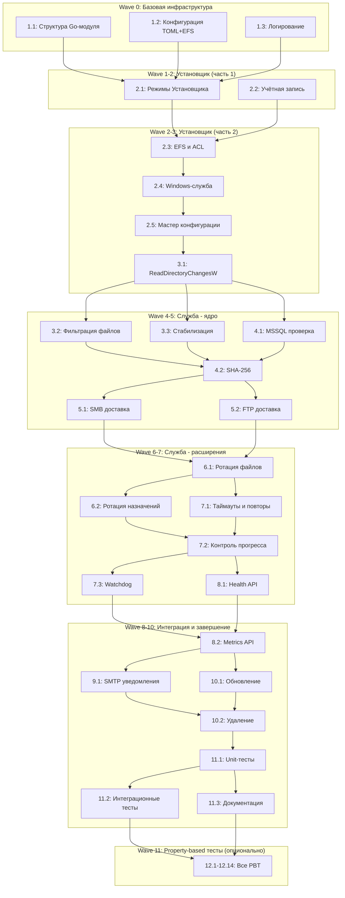

# Implementation Plan: Midarda-Backup

## Overview

Реализация системы Midarda-Backup включает создание двух исполняемых файлов для Windows: консольного установщика и службы резервного копирования. Работа разделена на логические фазы: инфраструктура, установщик, базовая служба, расширенная функциональность, мониторинг и тестирование. Каждая фаза включает задачи, ссылающиеся на конкретные требования из requirements.md (R1-R35 и У/С/Н).

## Tasks

### Фаза 1: Базовая инфраструктура и интерфейсы

- [ ] 1.1 Создать структуру Go-модуля и базовые пакеты
  - Инициализировать `go.mod` с минимальными зависимостями
  - Создать структуру каталогов: `cmd/installer`, `cmd/service`, `internal/app`, `internal/config`
  - Определить основные интерфейсы компонентов
  - _Requirements: R1 (У-03, Н-01), R34_

- [ ] 1.2 Реализовать модуль конфигурации (TOML + EFS)
  - Создать типизированные структуры конфигурации по design.md
  - Реализовать парсинг TOML с `BurntSushi/toml` и строгой валидацией
  - Добавить применение значений по умолчанию и cross-field validation
  - _Requirements: R7 (Н-06, С-19)_

- [ ] 1.3 Реализовать логирование (5 МБ × 5, русский язык)
  - Создать текстовый логгер UTF-8 с уровнями DEBUG/INFO/WARN/ERROR
  - Реализовать ротацию при достижении 5 МБ, хранение 5 архивных файлов
  - Поддержка русского языка в сообщениях и безопасное маскирование секретов
  - _Requirements: R15 (С-14–С-16, С-39)_

### Фаза 2: Установщик и жизненный цикл службы

- [ ] 2.1 Реализовать режимы Установщика и административные полномочия
  - Поддержка режимов установки, обновления, удаления с консольным интерфейсом
  - Проверка поддерживаемой версии Windows Server и архитектуры amd64
  - Запрос повышения через UAC при необходимости административных полномочий
  - _Requirements: R1 (У-01, У-02), R2 (У-20, У-04)_

- [ ] 2.2 Управление сервисной учётной записью Windows
  - Создание/обновление локальной учётной записи `midarda-backup`
  - Назначение права `SeServiceLogonRight`
  - Проверка пароля системными API Windows без дополнительных правил сложности
  - _Requirements: R3 (У-05, У-06), R35_

- [ ] 2.3 Работа с файлами, EFS и ACL
  - Атомарное копирование поставляемых файлов в `%ProgramData%\Midarda-Backup`
  - Шифрование всего файла конфигурации EFS в профиле сервисной учётной записи
  - Проверка атрибута шифрования и чтение EFS-конфигурации
  - Назначение владельца каталога и ACL (только `midarda-backup` и `SYSTEM`)
  - _Requirements: R4 (У-07–У-09, У-22, У-23)_

- [ ] 2.4 Регистрация и жизненный цикл Windows-службы
  - Регистрация службы `Midarda-Backup` в SCM с типом запуска Automatic (Delayed Start)
  - Передача пароля SCM и настройка перезапуска после ненулевого завершения
  - Запуск службы и ожидание состояния Running с проверкой Health API
  - Обработка команд SCM (Pause, Continue, Stop, Shutdown)
  - _Requirements: R5 (У-10, У-24, С-17)_

- [ ] 2.5 Мастер конфигурации и проверка доступа
  - Интерактивный запрос источника, SMB и FTP назначений
  - Предоставление значений по умолчанию и проверка пустых назначений
  - Проверка создания/чтения/удаления тестовых файлов в контексте сервисной учётной записи
  - Проверка подключения к MSSQL при включённой проверке целостности
  - _Requirements: R6 (У-11–У-19)_

### Фаза 3: Служба — обнаружение и стабилизация файлов

- [ ] 3.1 Реализовать мониторинг каталога через ReadDirectoryChangesW
  - Использование `ReadDirectoryChangesW` с наблюдением поддерева
  - Фильтрация путей по допустимой глубине (0, 1, 2)
  - Объединение событий одного файла и обработка переполнения буфера
  - _Requirements: R8 (С-03, С-36)_

- [ ] 3.2 Реализовать фильтрацию файлов по маскам
  - Регистронезависимое соответствие basename хотя бы одной маске файлов
  - Исключение файлов с суффиксом `.sha256`, каталогов и недопустимых путей
  - Поддержка масок Windows-style (`*.bak`, `*.trn`)
  - _Requirements: R8 (С-05)_

- [ ] 3.3 Реализовать стабилизацию файлов
  - Успешное открытие файла без совместного доступа на запись и удаление
  - Проверка неизменности пары «размер, время изменения» в течение настроенного интервала
  - Перезапуск стабилизации при изменении файла или невозможности открытия
  - _Requirements: R8 (С-04)_

### Фаза 4: Служба — проверка MSSQL и SHA-256

- [ ] 4.1 Реализовать блокирующую проверку MSSQL (RESTORE VERIFYONLY)
  - Выполнение `RESTORE VERIFYONLY` для абсолютного пути внутри источника
  - Поддержка Windows-auth и SQL-auth с безопасным экранированием кавычек
  - Блокировка создания sidecar, публикации и ротации при ошибке целостности
  - _Requirements: R9 (С-20–С-24, С-37)_

- [ ] 4.2 Реализовать вычисление SHA-256 и формат Sidecar
  - Потоковое вычисление SHA-256 файла резервной копии
  - Атомарное создание локального sidecar файла
  - Формат: `<64 строчных hex символа><два пробела><basename>\n`
  - _Requirements: R10 (С-06)_

### Фаза 5: Служба — доставка в SMB и FTP/FTPS

- [ ] 5.1 Реализовать независимую доставку в SMB
  - Обращение к абсолютному UNC-пути без подключения сетевого диска
  - Атомарная публикация через временные файлы `.partial-*`
  - Обратная проверка SHA-256 при включённом `verify_after_copy`
  - _Requirements: R11 (С-07, С-09, С-38)_

- [ ] 5.2 Реализовать независимую доставку в FTP/FTPS
  - Поддержка plain FTP и explicit FTPS с проверкой сертификата
  - Пассивный бинарный режим и атомарное переименование при поддержке
  - Успешный протокольный ответ как достаточное подтверждение публикации
  - _Requirements: R11_

### Фаза 6: Служба — ротация локальных и удалённых копий

- [ ] 6.1 Реализовать детерминированную ротацию файлов
  - Учёт всех обычных файлов (включая sidecar) в непосредственном каталоге
  - Сортировка по `(mtime DESC, нормализованный путь ASC)`
  - Удаление файлов сверх лимита `keep` (0 означает удалить все)
  - _Requirements: R12 (С-11–С-13)_

- [ ] 6.2 Реализовать независимую ротацию для каждого назначения
  - Удалённая ротация в соответствующих подкаталогах успешных назначений
  - Локальная ротация в подкаталогах каталога источника
  - Идемпотентность при повторном применении к неизменённому каталогу
  - _Requirements: R12_

### Фаза 7: Служба — таймауты, повторы и watchdog

- [ ] 7.1 Реализовать политику таймаутов и повторов
  - Отдельные таймауты операций для SMB, FTP и MSSQL
  - Exponential backoff: `min(max_interval, initial_interval × multiplier^(i-1))`
  - Ограничение общего числа попыток значением `max_attempts`
  - _Requirements: R13 (С-29, С-33–С-35)_

- [ ] 7.2 Реализовать контроль прогресса операций
  - Мониторинг увеличения обработанных байтов и сигналов активности
  - Отмена операции как `stalled` при превышении `progress_timeout`
  - Классификация ошибок на временные и постоянные
  - _Requirements: R13 (С-30, С-31)_

- [ ] 7.3 Реализовать watchdog и восстановление после зависания
  - Обновление heartbeat при извлечении транзакции и завершении этапов
  - Независимый контроль возраста heartbeat с заданным `watchdog_timeout`
  - Завершение процесса с marker при превышении таймаута
  - Восстановление через SCM recovery policy
  - _Requirements: R14 (С-28, С-32)_

### Фаза 8: Служба — Health API и Metrics API

- [ ] 8.1 Реализовать Health API с проверкой доступа по CIDR
  - HTTP endpoint `/health` на порту 91873 (по умолчанию)
  - Проверка IP клиента на принадлежность разрешённой подсети
  - JSON ответ с состоянием службы, версией конфигурации, ресурсами
  - Классификация состояния: `healthy`, `degraded`, `unhealthy`
  - _Requirements: R16 (С-40–С-43)_

- [ ] 8.2 Реализовать Metrics API для Prometheus/Zabbix
  - HTTP endpoint `/metrics` в текстовом формате Prometheus
  - Счётчики транзакций, операций назначений, повторов, скопированных байтов
  - Исключение секретов и полных путей из labels
  - _Requirements: R16_

### Фаза 9: Служба — SMTP-уведомления

- [ ] 9.1 Реализовать SMTP-уведомления
  - Поддержка STARTTLS с проверкой сертификата
  - Асинхронная очередь для WARN, ERROR и alert событий
  - Отправка уведомлений о зависших транзакциях и сбоях
  - _Requirements: R17 (С-25–С-27)_

### Фаза 10: Обновление и удаление

- [ ] 10.1 Реализовать режим обновления с сохранением конфигурации
  - Запрос решения о сохранении существующей EFS-конфигурации
  - Проверка расшифрования и валидности сохраняемой конфигурации
  - Замена бинарников и повторное применение ACL/SCM policy
  - _Requirements: R18 (У-26)_

- [ ] 10.2 Реализовать режим удаления с подтверждениями
  - Остановка и удаление службы перед удалением файлов/пользователя
  - Отдельные подтверждения для удаления конфигурации, файлов и учётной записи
  - Предупреждение о потере доступа к EFS-ключу при удалении учётной записи
  - _Requirements: R18 (У-27)_

### Фаза 11: Тестирование и документация

- [ ] 11.1 Создать unit-тесты чистой логики
  - Тесты парсинга конфигурации и validation
  - Тесты планирования ротации и фильтрации путей
  - Тесты вычисления SHA-256 и форматирования sidecar
  - _Requirements: R19 (Н-03)_

- [ ] 11.2 Создать интеграционные тесты
  - Тесты взаимодействия с Windows API (учётные записи, EFS, SCM)
  - Тесты MSSQL, SMB, FTP/FTPS с тестовыми серверами
  - Тесты Health/Metrics API и SMTP
  - _Requirements: R19_

- [ ] 11.3 Создать документацию
  - `README.md` с описанием проекта
  - Инструкция администратора на русском языке
  - Схема развёртывания и эксплуатационные рекомендации
  - _Requirements: R19 (Н-04, Н-07)_

### Фаза 12: Property-based тесты (опциональные)

- [ ]* 12.1 Написать property test P-01: Round trip Конфигурации
  - Проверка сериализации/десериализации произвольных допустимых конфигураций
  - _Requirements: R20_

- [ ]* 12.2 Написать property test P-02: Безопасная фильтрация пути
  - Проверка классификации произвольных путей относительно каталога источника
  - _Requirements: R21_

- [ ]* 12.3 Написать property test P-03: Граница Стабилизации
  - Проверка определения готовности файла на произвольных последовательностях наблюдений
  - _Requirements: R22_

- [ ]* 12.4 Написать property test P-04: Round trip Sidecar
  - Проверка сохранения SHA-256 и basename при сериализации/десериализации sidecar
  - _Requirements: R23_

- [ ]* 12.5 Написать property test P-05: Эквивалентность SMB-проверки
  - Проверка совпадения SHA-256 локального и удалённого содержимого
  - _Requirements: R24_

- [ ]* 12.6 Написать property test P-06: Независимость назначений
  - Проверка независимой обработки и вычисления статуса транзакции
  - _Requirements: R25_

- [ ]* 12.7 Написать property test P-07: Детерминированная Ротация
  - Проверка детерминированности и идемпотентности планировщика ротации
  - _Requirements: R26_

- [ ]* 12.8 Написать property test P-08: Атомарность reload
  - Проверка полной замены или сохранения снимка конфигурации
  - _Requirements: R27_

- [ ]* 12.9 Написать property test P-09: MSSQL gate
  - Проверка блокировки этапов при неуспешной проверке MSSQL
  - _Requirements: R28_

- [ ]* 12.10 Написать property test P-10: Ограниченный exponential backoff
  - Проверка ограничений числа попыток и вычисления задержек
  - _Requirements: R29_

- [ ]* 12.11 Написать property test P-11: Строгая граница отсутствия прогресса
  - Проверка классификации операций как `stalled` по возрасту последнего прогресса
  - _Requirements: R30_

- [ ]* 12.12 Написать property test P-12: Полный fan-out Оповещений
  - Проверка маршрутизации типизированных событий в SMTP-очередь
  - _Requirements: R31_

- [ ]* 12.13 Написать property test P-13: CIDR как единственный источник решения о доступе
  - Проверка принятия решения по HTTP-доступу только на основе socket IP
  - _Requirements: R32_

- [ ]* 12.14 Написать property test P-14: Безопасный round trip Health JSON
  - Проверка сохранения состояния и исключения секретов при сериализации Health JSON
  - _Requirements: R33_

## Notes

- Задачи, отмеченные `*`, являются опциональными (property-based тесты) и могут быть пропущены для ускорения разработки MVP.
- Каждая задача содержит ссылки на конкретные требования из requirements.md для обеспечения трассируемости.
- Реализация должна следовать архитектуре, описанной в design.md.
- Все секреты (пароли, строки подключения) должны быть защищены и никогда не попадать в логи или HTTP-ответы.
- Система предназначена исключительно для Windows Server 2019, 2022, 2025 на архитектуре amd64.

## Task Dependency Graph

```json
{
  "waves": [
    { "id": 0, "tasks": ["1.1", "1.2", "1.3"] },
    { "id": 1, "tasks": ["2.1", "2.2"] },
    { "id": 2, "tasks": ["2.3", "2.4"] },
    { "id": 3, "tasks": ["2.5", "3.1"] },
    { "id": 4, "tasks": ["3.2", "3.3", "4.1"] },
    { "id": 5, "tasks": ["4.2", "5.1", "5.2"] },
    { "id": 6, "tasks": ["6.1", "6.2", "7.1"] },
    { "id": 7, "tasks": ["7.2", "7.3", "8.1"] },
    { "id": 8, "tasks": ["8.2", "9.1", "10.1"] },
    { "id": 9, "tasks": ["10.2", "11.1"] },
    { "id": 10, "tasks": ["11.2", "11.3"] },
    { "id": 11, "tasks": ["12.1", "12.2", "12.3", "12.4", "12.5", "12.6", "12.7", "12.8", "12.9", "12.10", "12.11", "12.12", "12.13", "12.14"] }
  ]
}
```



